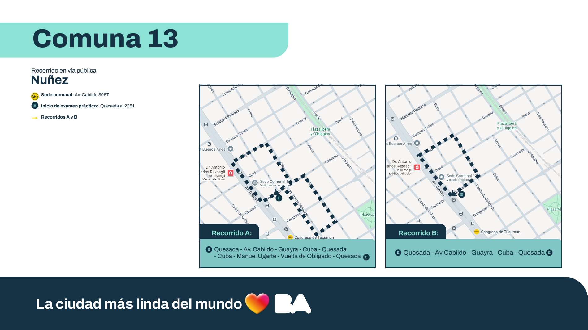

# Al volante: Comuna 13

Propuesta de juego web para preparar el examen teórico y práctico de licencia B/B.1 en CABA.

Fecha: 11 de octubre de 2026. Estado: propuesta aceptada; fase 1 iniciada el 2026-10-11 (ver [estado](specs/ESTADO_IMPLEMENTACION.md)). La ejecución se rige por [el plan de fases y PRs](specs/PLAN_IMPLEMENTACION.md); cada fase requiere inicio manual del usuario.

## 1. La experiencia

Un juego de conducción en primera persona ambientado en Núñez, acompañado por una campaña de aprendizaje que convierte el manual completo y el protocolo en decisiones, situaciones y desafíos. Gráficos con Three.js.

Entrás a tu garaje, elegís qué practicar y te sentás al volante. Regulás los espejos, te ponés el cinturón y escuchás al examinador. Afuera hay tránsito, peatones, bicicletas, colectivos y semáforos. Para avanzar tenés que observar, anticipar, señalizar y maniobrar. La tensión viene de resolver situaciones de conducción en tiempo real. Se premian el control, la previsión y la convivencia vial.

Al terminar, una repetición muestra tus decisiones: qué viste, qué hiciste, qué faltó y qué página del material lo explica. Desde ahí podés repetir esa misma situación.

## 2. Seis espacios conectados

| Espacio | Qué hacés | Para qué sirve |
|---|---|---|
| **Mi garaje** | Explorás un auto, ajustás postura y espejos, accionás instrumental y revisás elementos de seguridad. | Preparar la primera etapa y aprender el vehículo. |
| **La ciudad te pregunta** | Resolves escenas: ordenar prioridades, elegir luces, detectar peligros, ubicar documentación y decidir dónde estacionar. | Aprender todo el contenido, con explicaciones y referencias. |
| **Laboratorio vial** | Comparás distancias de reacción y frenado, lluvia, visibilidad, puntos ciegos y cargas. | Entender consecuencias mediante experimentos visuales. |
| **Ruta 13** | Conducís desde el interior del auto por el recorrido A, con instructor o en simulacro. | Preparar circulación y estacionamiento. |
| **Sala de examen** | Respondés preguntas equilibradas por tema, sin ayudas y con tiempo configurable. | Ensayar el teórico y medir progreso. |
| **Mi bitácora** | Revisás errores, repeticiones, temas pendientes y una sesión de repaso recomendada. | Evitar lagunas y consolidar lo aprendido. |

Ejemplo de sesión: cinco minutos de prioridades, una escena de giro con ciclista y diez minutos recorriendo calles. Si omitís mirar antes de doblar, la bitácora propone ese ejercicio para la próxima sesión.

## 3. Qué significa cubrir TODO

El manual tiene 200 páginas. Su página PDF 3 establece para categoría B: introducción, capítulos 1–5, anexo I y anexo IV. La propuesta cubre eso como campaña principal y además incluye los anexos II y III como contenido complementario, para satisfacer el pedido de cubrir todo el manual sin confundir las categorías.

| Contenido | Páginas PDF | Actividades propuestas |
|---|---:|---|
| Presentación, categorías, glosario e introducción | 2–20 | Diccionario interactivo, contexto vial, incidentes y responsabilidad colectiva. |
| Movilidad sustentable | 21–42 | Prioridad peatonal, bicicletas, monopatines, transporte público, infraestructura y convivencia. |
| Responsabilidad al conducir | 43–56 | Documentación, licencia, principiante, VTV, responsabilidades, scoring y actuación ante incidentes. |
| Normas básicas | 57–88 | Señales, prioridades, luces, velocidades, distancias, giros, sobrepasos, autopistas, clima y estacionamiento. |
| Capacidad natural | 89–97 | Alcohol, drogas, fatiga, sueño, estrés, distracciones y GPS. |
| Actitud al conducir | 98–103 | Prevención, convivencia, igualdad, asistencia ante violencia de género y conducción eficiente. |
| Automóviles particulares | 104–122 | Frenos, neumáticos, espejos, cinturón, apoyacabezas, airbag, SRI, mascotas, equipaje y elementos de seguridad. |
| Transporte de pasajeros | 123–151 | Módulo complementario completo de sus particularidades y responsabilidades. |
| Transporte de carga | 152–183 | Módulo complementario completo de cargas, seguridad, salud y circulación. |
| Señales viales | 184–198 | Catálogo visual completo: reconocimiento, significado y aplicación en escenas. |
| Páginas finales | 199–200 | Revisar visualmente y registrar su contenido antes de cerrar cobertura. |
| Protocolo | 1–42 | Procedimiento completo, tres etapas, ficha, clasificación de fallas, anexos y recorridos. |
| Guía de siniestros | 1–24 | Módulo adicional de decisiones, datos a recabar, seguros y orientación de la guía. |

La cobertura se audita por unidad de conocimiento, tabla, figura y señal. Cada unidad tendrá fuente y página, explicación, actividad y verificación. Leer una página o acertar una vez no bastará para marcarla como dominada. El panel distinguirá contenido disponible, practicado y dominado.

Los otros circuitos del protocolo y del PDF de recorridos estarán disponibles como material de consulta. El circuito que se reconstruye y conduce en 3D es Comuna 13 A.

El banco de preguntas será propio y revisado contra las fuentes. No se presentará como banco oficial. Su tamaño se decidirá por cobertura real, con variantes en los conceptos que necesiten práctica; ninguna cifra arbitraria sustituirá el inventario de contenido.

## 4. El práctico: al volante en Núñez

### Recorrido documentado

Fuente: `recorridosl.pdf`, página PDF 16, inspeccionada como texto y como imagen.

- Sede comunal: Av. Cabildo 3067.
- Inicio del examen: Quesada 2381.
- Secuencia textual A: **Quesada → Av. Cabildo → Guayra → Cuba → Quesada → Cuba → Manuel Ugarte → Vuelta de Obligado → Quesada**.
- Duración orientativa del recorrido: 15 minutos, según página PDF 5; no es una carrera contrarreloj.



**Pendiente cartográfico resuelto (F01-T04):** Cuba está desplazada en Quesada, unos 66 m. «Cuba – Quesada – Cuba» es izquierda por Quesada y derecha para retomar Cuba, no una repetición ni una vuelta en U. Trazado, sentidos, controles y aproximaciones en [specs/RECORRIDO.md](specs/RECORRIDO.md).

### Fidelidad del barrio

Se reconstruirán las calles y cruces del circuito a escala métrica, con coordenadas contrastadas con cartografía abierta y datos públicos. Se comprobarán sentidos, carriles, sectores exclusivos, cruces, semáforos y señalización relevante. El mapa oficial fija el circuito; no proporciona por sí solo todo ese detalle.

Los edificios tendrán una estética realista estilizada: veredas, fachadas, árboles, comercios, carteles y transporte que den identidad porteña. La geometría vial y las referencias para conducir tendrán prioridad sobre la exactitud de cada fachada. Cada elemento cartográfico registrará si está verificado o es una aproximación ambiental. La propuesta no supone que ya se dispone de un relevamiento actual de las calles.

### Interior interactivo

- Cámara principal desde los ojos de quien conduce, volante animado y tablero legible.
- Espejos interior y laterales que muestran el mundo real de la simulación.
- Mirada lateral y hacia atrás para observar puntos ciegos; retorno cómodo al frente.
- Cinturón, asiento, apoyacabezas, luces, giros, balizas, bocina, limpiaparabrisas, desempañadores, climatización, llave, freno de mano y caja de cambios.
- Transmisión manual y automática, con sus procedimientos diferenciados. La manual permite practicar embrague, punto de acople, arranque, detenciones y calado.
- Motor, intermitentes, tránsito y voz del examinador con subtítulos.
- Teclado y mouse como base, mando configurable; volante/pedales sujeto a compatibilidad comprobada. Controles táctiles para teoría y prácticas simplificadas, priorizando escritorio para el circuito completo.

### Tres etapas completas

1. **Preparación:** familiarización sin penalización cuando corresponde; luego comprobaciones con motor apagado y contacto, regulación, cinturón y reconocimiento de comandos.
2. **Maniobrabilidad y circulación:** retroceder y avanzar 30 cm con las condiciones de pedalera del protocolo, salir del cajón, ejecutar la indicación de los primeros 100 metros y conducir todo el circuito.
3. **Estacionamiento y descenso:** balizas, observación, estacionamiento paralelo, finalización, apagado y comprobación del tránsito antes de abrir la puerta.

### Formas de jugar

- **Aprender:** instructor, pausa, explicaciones, referencias visuales y práctica progresiva.
- **Practicar un tramo:** elegir salida, cruce, giro, cambio de carril o estacionamiento; repetir desde el mismo estado.
- **Recorrer:** circuito completo con tránsito variable y ayudas graduables.
- **Rendir:** tres etapas consecutivas, indicaciones del examinador, sin rebobinado ni ayudas didácticas. La devolución detallada llega al final; las observaciones durante la prueba seguirán el protocolo.
- **Desafíos:** lluvia, menor visibilidad y peligros variados en sesiones identificadas como entrenamiento. Las situaciones didácticas no se presentarán como obstáculos permanentes del recorrido real.

La observación se aproxima mediante orientación de cámara, selección de espejo y momento de la maniobra. El juego no mide movimientos reales de ojos ni puede evaluar por teclado la postura física o las manos reales; las acciones representadas se identificarán como práctica virtual.

## 5. Evaluación fiel al protocolo suministrado

Las reglas siguientes describen el PDF entregado, no una certificación independiente de vigencia normativa. La transcripción completa, con ficha y anexo conciliados, casos frontera y decisiones, está en [specs/REGLAS.md](specs/REGLAS.md), que prevalece sobre este resumen.

| Tipo de falla | Puntos |
|---|---:|
| Leve | 1 |
| Deficiente baja | 2 |
| Deficiente alta | 3 |
| Eliminatoria | 8 |

Se aprueba al finalizar las tres etapas con hasta 7 puntos; desde 8 se desaprueba. No todas las fallas eliminatorias interrumpen inmediatamente el recorrido: se modelará por separado el resultado y la interrupción. Fuente: protocolo, PDF 14 y anexo II, PDF 22–33.

Detalles que debe respetar la implementación:

- Máxima de examen: 30 km/h en calles y 45 km/h en avenidas, aplicando límites más restrictivos cuando correspondan (PDF 8, 10).
- Superar la velocidad de examen es deficiente alta; superar la máxima de la vía es eliminatoria. Resolver solapamientos según el anexo, sin duplicar automáticamente una misma conducta (PDF 16, 28, 32; verificar cada referencia al transcribir reglas).
- Luz de giro con 30 metros de anticipación; para cambio de carril, al menos 3 segundos; balizas para estacionar, al menos 3 segundos (PDF 12–13).
- Primeros 100 metros a no más de 30 km/h y en segunda para manual, según indicación del examinador (PDF 11).
- Estacionar en más de tres maniobras y hacerlo en más de dos intentos son fallas distintas; no contar cada corrección de volante como un intento (PDF 17, 24–25, 33).
- Cajón de 6 metros, según gráfico 4, PDF 21. Objetivo aproximadamente a 20 cm del cordón. Las franjas y consecuencias se extraen del gráfico y del anexo, sin sustituirlas por un umbral inventado.
- Algunas faltas se contabilizan una sola vez aunque haya varios errores: reconocimiento de luces e instrumental (protocolo PDF 22); vehículo descentrado o inclinado al estacionar, y no apagar el motor, no quitar la llave o no bloquear la dirección (PDF 25). Otras suman una falla cada vez que ocurren: roce del cordón (PDF 23); tirones, aceleración en vacío, motor detenido, manos fuera del volante y direccionales en giros (PDF 26); direccionales en cambios de carril o maniobras (PDF 27); roce de elementos del cajón (PDF 28). Las reglas tendrán política explícita de repetición; la transcripción completa queda en `REGLAS.md` (F01-T03).
- La intervención del doble comando y las interrupciones se representarán como toma de control del examinador.
- Al terminar: ficha por etapa, eventos con instante y ubicación, explicación, página fuente y acceso al ejercicio correctivo.

Los puntos de examen y las recompensas de aprendizaje serán independientes. Ninguna recompensa podrá compensar una falla eliminatoria.

## 6. Aprendizaje y progreso

Cada tema propone una secuencia breve: entender → resolver → aplicar → recordar. Habrá clasificación de señales, escenas de prioridad, inspección del auto, decisiones ramificadas y simulaciones de distancias. Las situaciones tendrán variantes para que aprender no dependa de memorizar una respuesta o ubicación.

La bitácora priorizará errores recientes y repasos espaciados. Registrará dominio por concepto y habilidades prácticas, evitando presentar una probabilidad inventada de aprobar. La campaña B tendrá progreso propio, separado del material profesional complementario.

Las medallas serán por conductas útiles: anticipación, observación, dominio del estacionamiento y constancia. Los resultados adversos llevarán a una explicación concreta y una oportunidad de practicar.

## 7. Apariencia y uso

Interfaz cuidada con azul noche, marfil y acentos turquesa; amarillo reservado para información vial y alertas. Tipografía clara, tarjetas sobrias y un mapa del barrio como acceso al recorrido. Durante la conducción, la información principal aparece en el tablero; las ayudas se muestran según el modo.

Pantallas: inicio/garaje, mapa de aprendizaje, biblioteca, actividad, preparación del vehículo, conducción, devolución y bitácora. Todo en español rioplatense, con subtítulos y controles reasignables. Opción de reducir movimientos de cámara; las señales conservarán sus colores y formas reglamentarias. La teoría se podrá usar con teclado y lectores de pantalla; el práctico ofrecerá ayudas visuales y sonoras ajustables.

## 8. Arquitectura propuesta

- TypeScript, Vite y React para interfaz y navegación; Three.js para el mundo 3D. Versiones a seleccionar y fijar al iniciar implementación.
- Física de conducción con paso temporal fijo, modelo de giro y neumáticos adecuado a baja velocidad y colisiones verificables. Evaluar Rapier para cuerpos y contactos, manteniendo el comportamiento del auto calibrado y comprobable.
- Motor de reglas separado del renderizado: consume eventos, determina faltas y construye la ficha.
- Contenido pedagógico estructurado en JSON validado, con referencias al PDF y control de cobertura.
- Grafo vial con coordenadas locales métricas, carriles y conexiones; conservar coordenadas geográficas y origen del dato.
- Tránsito con rutas, semáforos y escenarios reproducibles por semilla. Peatones y ciclistas participan de las prioridades y colisiones.
- Grabación de estados e inputs para devolución y repetición de ejercicios. El reinicio restaura vehículo, tránsito, semáforos y reglas.
- IndexedDB para progreso local y exportación/importación de respaldo. Sin cuenta obligatoria. Aplicación instalable y uso sin conexión una vez descargado el contenido necesario.
- Geometría instanciada, niveles de detalle, carga por sectores y calidad gráfica configurable; espejos con presupuesto de renderizado propio.
- Objetivo inicial de rendimiento: 60 FPS en escritorio de referencia y modo reducido utilizable a 30 FPS. Es un objetivo a medir, no un resultado ya obtenido.

Contratos de datos mínimos:

```text
Source: id, archivo, hash, versión/fecha, páginas, procedencia
KnowledgeUnit: id, tema, categoría, referencias, explicación, actividades
Activity: id, conceptos, instrucciones, evaluación, explicación, referencias
Rule: id, etapa, condición, excepciones, puntos, repetición, interrumpe, referencias
RoadSegment: id, geometría, carriles, sentido, límites, conexiones, evidencia
Scenario: id, semilla, estado inicial, actores, objetivos, reglas activas
Attempt: id, versión de contenido, modo, eventos, faltas, resultado
```

## 9. Fuentes, vigencia y asuntos pendientes

Se extrajeron manual, protocolo, recorridos y guía de siniestros. Se guardaron sus hashes, textos e índice por página en `specs/fuentes/`. La boleta de pago no forma parte del material educativo y no fue abierta.

El manual lleva 2023 en el nombre; los metadatos del archivo de recorridos indican marzo de 2026. Esto no prueba por sí solo vigencia jurídica. La app deberá mostrar la edición estudiada y verificar antes de publicar los datos susceptibles de cambio: documentación, VTV, alcohol, estacionamiento, contactos y formato de examen.

Consulta oficial exploratoria realizada el 11/10/2026:

- [Material de estudio](https://buenosaires.gob.ar/gcaba_historico/infraestructura/movilidad/curso-de-educacion-vial-para-otorgamiento-de-licencia/material-de-estudio-para-examen-teorico).
- [Nueva modalidad de licencias](https://buenosaires.gob.ar/gcaba_historico/licenciasdeconducir/conoce-la-nueva-modalidad-de-otorgamiento-de-licencias-de-conducir): menciona 40 preguntas y 34 respuestas correctas.
- [Procedimiento 2023](https://documentosboletinoficial.buenosaires.gob.ar/publico/PE-DIS-UPFYDT-DGHC-860-23-ANX.pdf): el resultado de búsqueda menciona 40 preguntas, 85% y 45 minutos.
- [Documento 2024](https://documentosboletinoficial.buenosaires.gob.ar/publico/PE-RES-SECGVC-SECGVC-109-24-ANX.pdf): el resultado de búsqueda menciona 40 minutos.

Estos resultados muestran diferencias de edición. Los documentos completos ya se contrastaron en [specs/REGLAS.md §8](specs/REGLAS.md): 40 preguntas, 34 correctas (85%), y tiempo de 45 minutos según la Disposición 860/2023 y la página oficial vigente, frente a los 40 minutos del informe de gestión 2024. No fijar el temporizador como oficial. Diseñar cantidad de preguntas, duración y umbral como configuración versionada. No mezclar reglas de fuentes diferentes sin documentarlo.

Pendientes para implementación: relevamiento cartográfico en terreno (posición del cajón, señalización de fuente única; ver [specs/RECORRIDO.md §7](specs/RECORRIDO.md)); la interpretación de Cuba–Quesada–Cuba quedó resuelta en F01-T04 (desplazamiento de 66 m); inventario de cada señal/figura; transcripción íntegra de la ficha y excepciones; resolución de discrepancias; prueba de controles y rendimiento. Caja manual/automática se ofrecerán como selección, sin bloquear la propuesta por esa preferencia.

## 10. Entregas y criterios de terminado

| Entrega | Resultado comprobable |
|---|---|
| 1. Contenido y mapa | Inventario completo por página, matriz de cobertura y recorrido georreferenciado contrastado. |
| 2. Primer tramo jugable | Interior, controles, espejos, física, salida del cajón y un cruce con tránsito y evaluación. |
| 3. Circuito completo | Comuna 13 A, tres etapas, manual/automático, tránsito y ficha de fallas. |
| 4. Campaña completa | Todas las unidades educativas, señales, laboratorio, simulacros y repaso. |
| 5. Pulido y validación | Sonido, rendimiento, accesibilidad de teoría, persistencia, instalación y comprobación de fuentes. |

Las entregas son hitos internos de un proyecto completo. Un prototipo de una calle no cumple el objetivo final.

Se considera terminado cuando:

- Cada unidad del manual y protocolo tiene tratamiento documentado y las relevantes para B tienen aprendizaje y evaluación; las páginas no instructivas están clasificadas explícitamente.
- El recorrido completo respeta el trazado validado, sus sentidos y cruces; las aproximaciones ambientales están identificadas.
- Se conduce libremente desde el interior: acelerar, frenar, girar, observar, señalizar, cambiar marchas y estacionar producen efectos físicos y de evaluación.
- Cada regla práctica puede comprobarse con un caso correcto, uno incorrecto y sus excepciones relevantes, incluidas faltas repetidas y condiciones de interrupción.
- La ficha se corresponde con el historial de eventos. Se verifican los límites 7/8, maniobras/intentos y velocidad de examen/vía.
- El progreso sobrevive al reinicio y puede respaldarse. Las actividades enlazan sus fuentes.
- Se recorre una sesión completa en navegador y se mide rendimiento con hardware y calidad registrados.
- Las specs y el documento de continuidad reflejan lo realmente implementado y lo que sigue pendiente.

## 11. Alcance de esta primera entrega

Esta entrega contiene la propuesta, las fuentes extraídas, dos láminas inspeccionadas y un documento de continuidad. No contiene todavía un juego implementado. El usuario inició la fase 1, definida en `specs/PLAN_IMPLEMENTACION.md`, el 2026-10-11. Ese plan detalla tareas, PRs, dependencias, revisiones y criterios de cierre; sus fases sustituyen como secuencia operativa a los cinco hitos generales de la sección 10.

## 12. Modelos y recursos confirmados

El usuario dispone de planes de **200 USD en Anthropic y 100 USD en OpenAI**, y declara menor disponibilidad de tokens en OpenAI. La estrategia operativa prioriza **Opus 5.5 para implementación** y reserva **GPT-6.1 Sol para revisión Codex** y asistencia focalizada. Detalles por fase en [ESTRATEGIA_MODELOS.md](specs/ESTRATEGIA_MODELOS.md). Se mantienen autorrevisión, revisión Codex/CodeRabbit según el presupuesto disponible y autorización manual para iniciar cada fase. Los importes no se convierten en una proporción de tokens; se ajustará el uso con las cuotas reales.
