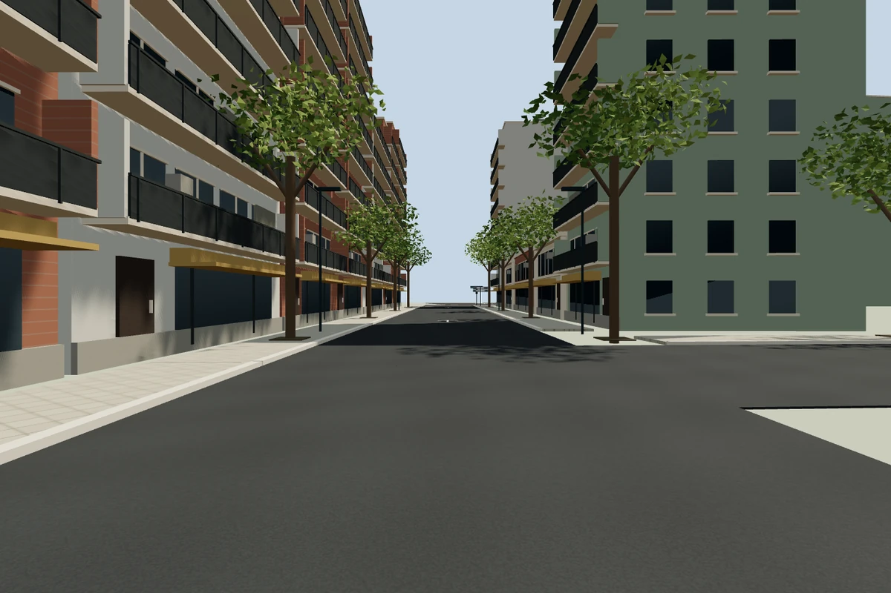
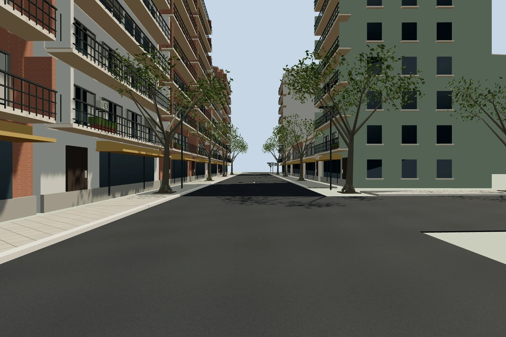
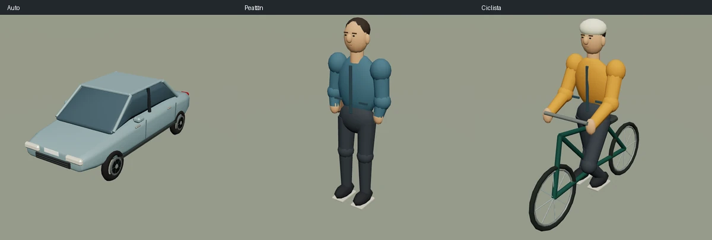

# Detalle gráfico del recorrido con Blender

Correctivo **F04-T01-FIX03**, solicitado por el usuario después de fusionar [#34](https://github.com/grunch/al-volante/pull/34). Parte de `main` en `f3d2f60`, en la rama `f04-t01-fix03-blender-detail` y un worktree independiente. Es una mejora de presentación del práctico; no inicia la fase 6.

## Referencias y resultado

Se volvieron a inspeccionar las **35 capturas** en orden cronológico, desde la salida hasta el regreso a Quesada. El inventario y la correspondencia con las calles están en [REFERENCIAS_VISUALES.md](REFERENCIAS_VISUALES.md). Las referencias muestran balcones con barandas, carpinterías retranqueadas, equipos en las fachadas, troncos ramificados y follaje irregular. Esos rasgos guían el nuevo detalle; no permiten medir cada parcela ni certificar el estado actual de la señalización.

Se ejecutó **Blender 5.2.0 LTS** para construir y exportar geometría original. La aplicación consume sus mallas evaluadas, incluidos biseles y normales, en lugar de recrear los detalles como cajas durante la conducción.

- **Calzada y vereda:** campos de altura de 256×256 generados con ruido de Blender, grano y juntas repetibles, relieve superficial y filtrado anisotrópico. Tapas con bandas antideslizantes y rejillas con marco y barrotes, distribuidas fuera de cruces.
- **Árboles:** base de raíces, tronco ahusado, ramas y ramillas, hojas individuales plegadas y dos densidades de copa. Se conservan las posiciones de plantación y la variación determinista.
- **Edificios:** marcos, alféizares, cortinas y reflejos en las ventanas cercanas; equipos de aire acondicionado con rejillas; barandas abiertas en los balcones tradicionales y juntas alternadas de ladrillo con antialias.
- **Semáforos:** carcasa biselada, placa amarilla, abrazaderas, aros y viseras abiertas. Las tres lentes siguen encendiéndose desde el estado del tránsito; no son luces pintadas en la malla.
- **Vehículos:** carrocerías perfiladas, pilares, espejos, ópticas, parrilla, manijas, limpiaparabrisas, neumáticos y llantas con rayos. Colectivos con puertas, ventanas divididas y ventilaciones; vehículo de emergencia con baliza.
- **Personas y bicicletas:** cabeza y rasgos genéricos, pelo, cuello, chaqueta, manos, articulaciones, calzado y bolso; ciclista con casco y bicicleta con cuadro, llantas, rayos, asiento y manubrio. Las proporciones humanas se conservan con escala uniforme.
- **Sombras:** mapa estático local de 2048², más definido que el anterior de 1024². Los actores tienen una sombra de contacto propia que los acompaña y no deja siluetas en el mapa estático.

Son modelos estilizados, sin marcas y de dimensiones aproximadas. No hay fotogrametría, reproducción de personas reales ni reconstrucción exacta de todos los frentes. Persisten diferencias ya registradas, como los autos estacionados y el cableado ausentes y el pintado continuo de la ciclovía. El recorrido, las cajas de colisión, las reglas y las posiciones evaluadas de señales y cajón conservan los datos anteriores.

## Procedencia y reproducción

`scripts/blender/build_city_kit.py` es la fuente editable del catálogo. El script, las mallas, los colores y las texturas se crearon para este proyecto y no incorporan recursos de terceros. No se descargaron modelos ni se agregaron dependencias o servicios. Las capturas de Street View se usaron únicamente como referencia: no se incluyen sus píxeles, texturas, marcas, patentes o rostros en el juego ni en Git.

Desde la raíz del repositorio, con Blender 5.2 instalado:

```sh
blender --background --factory-startup \
  --python scripts/blender/build_city_kit.py -- \
  --output src/assets/blender/city-kit.json \
  --blend-output test-results/blender/city-kit.blend
```

Con la instalación Flatpak usada en la verificación:

```sh
flatpak run --filesystem="$PWD" org.blender.Blender \
  --background --factory-startup \
  --python "$PWD/scripts/blender/build_city_kit.py" -- \
  --output "$PWD/src/assets/blender/city-kit.json" \
  --blend-output "$PWD/test-results/blender/city-kit.blend"
```

El `.blend` opcional organiza las doce familias en colecciones separadas, sobre una grilla, para inspeccionarlas en Blender. Se guarda en `test-results/`, fuera de Git. La fuente reproducible es el script; editar manualmente ese `.blend` no cambia el catálogo ni reemplaza al generador. La web usa el catálogo versionado y **no necesita Blender para instalar, compilar o jugar**.

El archivo `src/assets/blender/city-kit.json` contiene posiciones `float32`, normales `int16` normalizadas, colores lineales `uint8` e índices `uint16`, codificados en base64 por acabado. Las alturas de asfalto y vereda se almacenan en el mismo archivo. El exportador ordena vértices y triángulos sin invertir las caras para evitar diferencias de enumeración entre ejecuciones de Blender; dos ejecuciones completas dieron archivos idénticos, comprobados con `cmp`. `src/scene/blenderAssets.ts` valida el formato y conserva únicamente datos de CPU en su caché; cada escena o sector posee y libera sus geometrías y materiales. Ventanas, árboles, rejillas y tapas se agrupan por instancias y acabado dentro de cada sector.

El catálogo ocupa **1.502.548 bytes sin comprimir**. El límite probado es menor que 6.000 triángulos por familia:

| Familia | Triángulos |
|---|---:|
| Auto | 3.644 |
| Colectivo | 3.776 |
| Emergencia | 3.052 |
| Peatón | 2.856 |
| Bicicleta con ciclista | 4.320 |
| Árbol denso / ralo | 3.984 / 2.304 |
| Semáforo, sin las lentes dinámicas | 1.284 |
| Ventana | 388 |
| Aire acondicionado | 492 |
| Rejilla | 452 |
| Tapa de inspección | 468 |

## Comparación visual

Capturas de la aplicación, en el mismo punto de Quesada, con cámara a 1,7 m, campo visual de 65°, viewport 1440×960 y DPR 1. No son las imágenes de referencia del usuario.

Antes, después de #34:



Después:



Detalle de los modelos originales, renderizados con Three.js a partir del catálogo:



## Verificación y límites

Se revisaron en navegador los ocho tramos, la vista de cabina, pantalla completa, espejos, movimiento por teclado, frenado y restauración. En 393×851 con movimiento reducido no apareció desborde horizontal. Las pruebas E2E focalizadas de ciudad, cabina, examen y pista aprobaron **32 casos**, en escritorio y Pixel 7 emulado, con Chromium y GPU nativa. La emulación de tamaño y controles móviles no certifica rendimiento en un teléfono real.

Las pruebas de modelos comprueban contornos, normales, índices, presupuesto de triángulos, proporciones del ciclista, separación de las sombras estáticas y liberación independiente de recursos. La revisión independiente local detectó un árbol demasiado pesado y un ciclista comprimido: se redujo el follaje a dos triángulos por hoja y se corrigió la altura visual conservando la huella de colisión.

Tras los ajustes finales de normales y orden del exportador se repitieron las pruebas afectadas: **29/29 aprobadas**, además de lint, tipos y build. La suite general se registra en `ESTADO_IMPLEMENTACION.md` y en el PR. El build advierte sobre tamaños de bloques: el bloque diferido del habitáculo, que incluye el catálogo, ocupa 1.526,76 kB sin comprimir y 533,82 kB con gzip. No se amplió ni se ocultó el umbral de esa advertencia.

Medición del 2026-10-12 en Linux, Chromium 153 con ANGLE/OpenGL y NVIDIA GeForce RTX 2060. Escena de Quesada con cabina y tres espejos, semilla de tránsito 1 avanzada exactamente 600 pasos de 1/120 s, imagen de 811×456 y DPR 1. Se congeló la simulación para medir únicamente renderizado: diez cuadros de calentamiento y promedio de 120 cuadros con `gl.finish()`.

| Medida | Base de #34 | Con Blender |
|---|---:|---:|
| Tiempo de renderizado por cuadro | 4,91 ms | 9,76 ms |
| Llamadas de dibujo, incluidos espejos | 331 | 546 |
| Triángulos procesados, incluidos espejos | 1.360.692 | 2.900.888 |

En otra comprobación de la **aplicación con simulación activa**, los 180 intervalos entre cuadros promediaron 16,67 ms, con percentil 95 de 16,8 ms. El arranque, aceleración, giro breve, frenado y restauración funcionaron. Las mediciones iniciales mientras se ejecutaban otros navegadores E2E en paralelo fueron más lentas (46,76 ms de media); la muestra final se tomó después de terminarlos. Son muestras locales, no una certificación de 60 FPS en todo el recorrido o en teléfonos. El detalle adicional aumenta geometría, llamadas de dibujo, descarga y memoria; falta medir dispositivos con GPU integrada y móviles reales.
