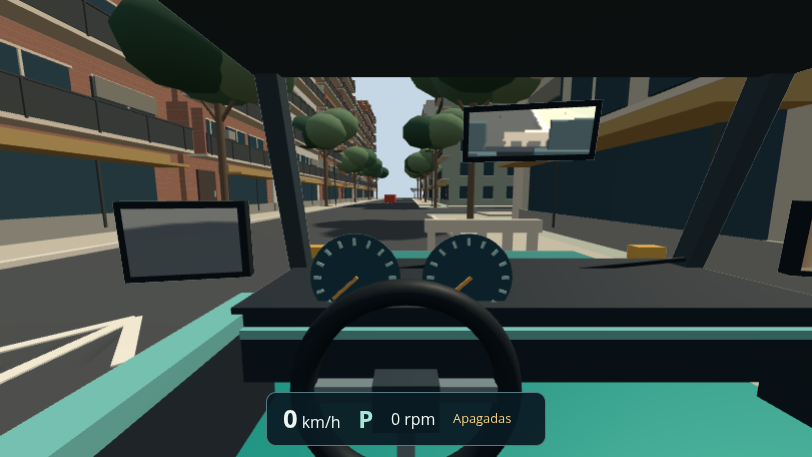
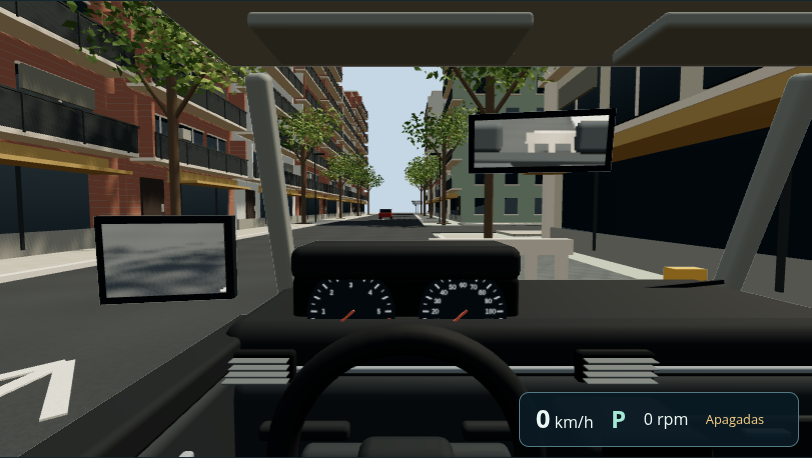

# Experiencia de conducción — F04-T01-FIX02

Pedido puntual del usuario del 2026-10-12 después de fusionar [#31](https://github.com/grunch/al-volante/pull/31): hacer más real el manejo y volver a contrastar la experiencia con las imágenes del recorrido. Base `main` (`9bc0257`), rama `f04-t01-fix02-driving-realism`, worktree independiente. No inicia la fase 6 ni modifica el trabajo de contenido de Opus.

## Resultado y límites

- **Dirección progresiva con teclado y botones:** conserva el recorrido completo del volante a velocidad de maniobra; al aumentar la velocidad, una tecla sostenida solicita un giro menor y más gradual. La vuelta al centro es suave estando detenido y más rápida al rodar. Se usa la magnitud de la velocidad también en reversa y se integra dentro del paso fijo. Es una asistencia para entradas binarias, no una dirección física de desmultiplicación variable ni un límite del examen. El volante por inclinación del celular es una entrada continua y no usa esta asistencia ([CONDUCCION_MOVIL.md](CONDUCCION_MOVIL.md), §6). La geometría de giro, adherencia, frenado y transmisión del simulador mantienen sus parámetros.
- **Sensación de peso:** desplazamiento e inclinación pequeños, amortiguados y derivados de la aceleración longitudinal y lateral del auto. El movimiento de la cabeza está separado de la física y no crea observaciones del examinador. La mirada conserva exactamente los comandos del jugador. Se reinicia ante una reposición, teletransporte o intervalo largo; `prefers-reduced-motion` lo desactiva en vivo, sin reiniciar la conducción. El reloj visual se interpola junto con la posición.
- **Habitáculo:** tablero redondeado, consola, salidas de aire, puertas, asientos, viseras, volante y diales numerados con agujas vinculadas a velocidad y régimen reales. Campo vertical de 64°, frente a 78°, y posición de cámara ajustada para reducir la deformación del gran angular. Es un modelo original aproximado de auto compacto, sin marca ni dimensiones certificadas. Se conservan los tres espejos con reflexión del mundo y sus ajustes.
- **Pantalla completa:** disponible desde la cabina, conserva los controles accesibles y devuelve el foco al área de conducción. Fallos o falta de soporte se informan en la interfaz. El indicador digital se desplaza a la derecha para despejar el volante.
- **Entorno:** grano de asfalto estable en coordenadas del mundo, baldosas y juntas con mipmaps, variación de vidrios y vegetación con hojas y huecos en la copa. Los actores dejan de ser bloques: vehículos, colectivos, emergencias, peatones y bicicletas tienen siluetas reconocibles dentro de sus cajas evaluadas. Los modelos no agregan vehículos estacionados ni nuevos obstáculos.

La nueva lectura de las referencias cubrió salida y regreso de Quesada, Cabildo, Guayra, ambos sectores de Cuba, Ugarte y Obligado. Las fotos motivan escala perceptiva, textura y arboleda; no miden fuerzas, dimensiones del auto ni coeficientes físicos. Inventario cronológico y procedencia en [REFERENCIAS_VISUALES.md](REFERENCIAS_VISUALES.md). El asfalto continuo de la ciclovía, el cableado ausente y la distribución aproximada de las fachadas siguen siendo diferencias respecto de las fotos (las dos primeras se corrigieron después en F04-T01-FIX05; ver [INMERSION_RECORRIDO.md](INMERSION_RECORRIDO.md)). No se presenta el resultado como una reconstrucción fotográfica.

## Implementación y recursos

`src/practice/controls.ts` dosifica las entradas; `drivingLoop.ts` entrega la velocidad de cada paso fijo. `src/scene/driverMotion.ts` contiene la respuesta visual y `cabinInterior.ts` genera el interior. `actorModel.ts` agrupa por acabado los modelos del tránsito, con color por vértice. Las superficies están en `src/city/surfaceTexture.ts`; las copas de los árboles pasaron al catálogo de Blender en F04-T01-FIX03 ([DETALLE_GRAFICO_BLENDER.md](DETALLE_GRAFICO_BLENDER.md)).

Geometrías, dibujos de instrumentos y texturas son originales y reproducibles desde código. No hay descargas, assets de terceros, fotos de Street View incrustadas ni dependencias nuevas. No fue necesario usar Blender: la construcción procedural permite agrupar el interior estático y compartir geometría por sector. Las texturas se liberan al retirar cada sector o cabina, y la retirada de un actor libera también sus piezas hijas.

## Verificación

Pruebas de regresión: giro a baja velocidad, sensibilidad a 30/45 km/h y en reversa, retorno sin sobrepasar el centro; determinismo a 30/120 cuadros por segundo; aceleración, frenado, giro, reposo y reposición de cámara; movimiento reducido sin alterar mirada/asiento; pantalla completa sin reinicio; contornos de los cinco tipos de actor y liberación de geometrías, materiales y texturas.

Se verifican en Chromium la conducción por teclado, frenado, reinicio, espejos, controles de cabina, pantalla completa y adaptación a móvil. Medición de render con RTX 2060, Chromium/ANGLE OpenGL ES 3.2, lienzo de 811 × 456, DPR 1, Quesada y tránsito con semilla 1 tras cinco segundos simulados: la escena completa pasó de 549 a 331 llamadas de dibujo; aumentó de aproximadamente 1,01 a 1,36 millones de triángulos por cuadro contando reflejos. Una muestra de 12 renders calentados con sincronización GPU dio 11,6 ms antes y 9,9 ms después. Había otros procesos de pruebas en ejecución: estos valores no certifican 60 FPS en todo el circuito ni en otros equipos. El resultado operativo final de checks y navegador se registra en `ESTADO_IMPLEMENTACION.md`.

## Comparación visual

Capturas propias de la aplicación en Quesada, mismo punto de entrada, ventana 1440 × 960 y DPR 1. La cabina anterior pertenece a #31; la nueva corresponde a `404ea74`. Se incluyen como evidencia visual liviana de este correctivo, sin material fotográfico externo.

| Antes | Después |
|---|---|
|  |  |

En una segunda medición de la aplicación completa, después de agrupar también los actores, 180 cuadros en el mismo equipo dieron media de 16,67 ms y p95 de 16,7 ms tanto en la base como en el correctivo. La prueba incluyó arranque automático, avance, giro breve, frenado, reinicio, espejos, pantalla completa y móvil; los 32 E2E de ciudad, cabina, examen y pista también pasaron en escritorio y móvil.
