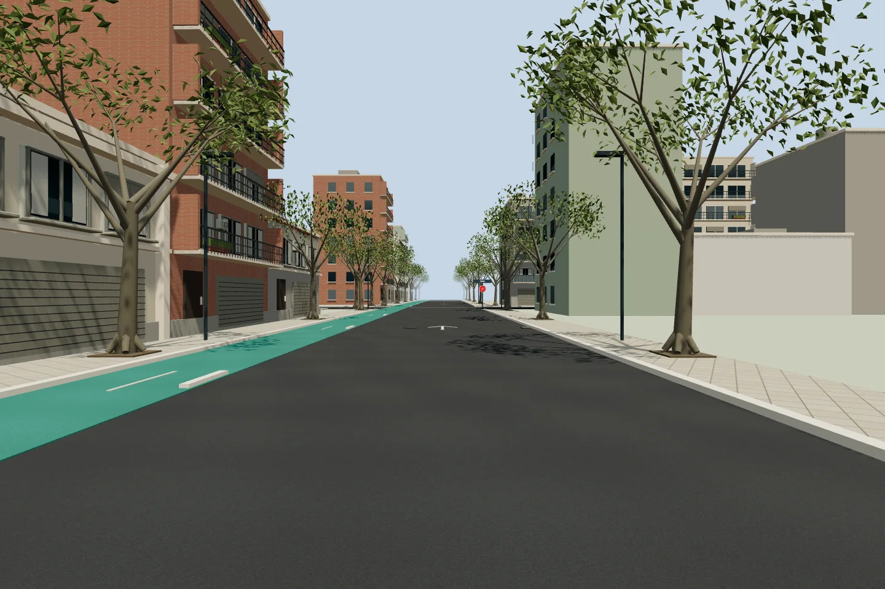
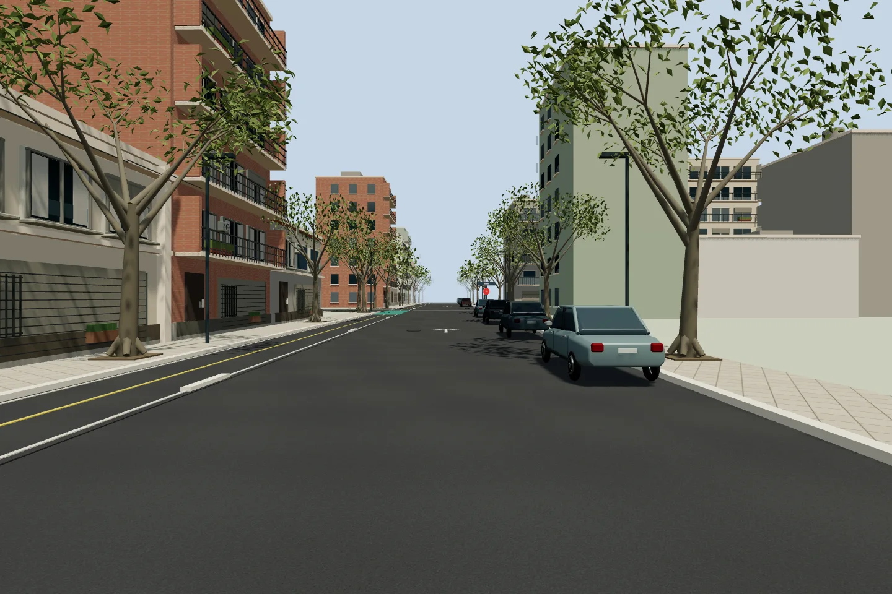
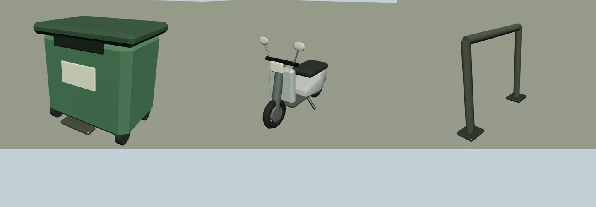

# Inmersión visual y sonora del recorrido

Correctivo **F04-T01-FIX05**, solicitado después de fusionar #35. Rama `f04-t01-fix05-route-immersion`, desde `main` en `132409a`, en un worktree independiente. El pedido autoriza detalle gráfico, sonidos y pruebas del práctico; no inicia el resto de la fase 6.

## Segunda lectura de la secuencia completa

Se inspeccionaron nuevamente las **35 capturas**, ordenadas por el nombre `Screenshot_2026-10-12_HH-MM-SS.png`, del inicio al regreso al mismo punto. El inventario original está en [REFERENCIAS_VISUALES.md](REFERENCIAS_VISUALES.md). Las horas siguientes identifican archivos, no fechas de relevamiento urbano: las panorámicas mezclan estaciones y fechas.

| Archivos: primera y última hora de cada grupo | Calle y rasgos observados | Traducción a la escena |
|---|---|---|
| 12-15-06 → 12-15-20 | Quesada: balcones de ladrillo y franjas claras, comercios bajos, barreras blancas, autos junto a ambos cordones | Se conserva la arquitectura previa; nuevos porteros, zócalos, cartelería genérica y estacionados fuera de la zona de salida |
| 12-15-36 → 12-16-39 | Cabildo: Metrobús, barandas, locales, toldos, contenedores y tendidos | Se conservan refugios y señales; se agregan detalles de locales, cables y objetos de vereda. No se agregan autos al cordón donde ocuparían los dos carriles modelados |
| 12-16-54 → 12-17-28 | Guayra: fachadas bajas y altas, accesos de garaje, filas de estacionados y árboles irregulares | Estacionados, rejas, porteros, plintos y pequeños canteros |
| 12-17-43 → 12-18-54 | Cuba: ciclovía de asfalto con eje amarillo, blanco en los bordes y verde en cruces; edificios con rejas y balcones | Corrección del verde continuo previo; vehículos solo del lado sin ciclovía, mobiliario y detalle de planta baja |
| 12-19-07 → 12-19-18 | Enlace por Quesada: frentes comerciales y cruce verde | Se conserva el desplazamiento Cuba–Quesada–Cuba; señalética comercial y detalle de fachada |
| 12-20-40 → 12-21-28 | Cuba: copas frondosas, contenedores, accesos, bicicletas y esquina comercial verde hacia Ugarte | Contenedores, scooters y bicicleteros de Blender; se conserva la esquina interpretada en la mejora anterior |
| 12-21-47 → 12-22-05 | Ugarte: frentes clásicos con rejas y modernos, estacionados | Rejas, bajadas pluviales y detalle de accesos. El estacionamiento se omite donde los carriles actuales no dejan ancho libre |
| 12-22-19 → 12-22-53 | Obligado: arboleda, garajes y autos junto a los cordones | Estacionados, detalles de plantas bajas, cableado y mobiliario |
| 12-23-05 → 12-23-58 | Regreso por Quesada al punto de partida | Mismo entorno y misma zona de maniobra reservada; no se crea un segundo punto de llegada |

Las posiciones de cada objeto, colores, dimensiones y nombres comerciales son **interpretaciones aproximadas**. No se realizó fotogrametría ni una reconstrucción catastral de cada frente. Los carteles dicen rubros genéricos; no reproducen marcas, domicilios privados, patentes ni personas de las fotos. Las imágenes originales no se redistribuyen ni se usan como texturas.

## Modelado y detalle

Se ejecutó **Blender 5.2.0 LTS**. El generador existente incorpora un contenedor con tapa, boca, pedal, ruedas y manijas; scooter con neumáticos, discos, asiento, horquilla, faro, espejos y apoyo; y bicicletero con placas de anclaje. El catálogo pasa de doce a **diecinueve familias**, incluidas cuatro variantes para distancia. Se mantienen los autos, peatones, ciclistas, semáforos, ventanas y árboles detallados de #35.

| Familia nueva | Triángulos |
|---|---:|
| Contenedor | 448 |
| Scooter | 1.064 |
| Bicicletero | 172 |
| Árbol lejano denso / ralo | 720 / 552 |
| Auto lejano | 196 |
| Ventana lejana | 24 |

Catálogo completo: **1.674.189 bytes**, sin comprimir. El `.blend` organiza las diecinueve colecciones y queda en `test-results/`, sin versionar. Fuente, licencias propias y comandos de regeneración: [DETALLE_GRAFICO_BLENDER.md](DETALLE_GRAFICO_BLENDER.md#procedencia-y-reproducción). La web no requiere Blender instalado. Dos exportaciones completas se comparan byte a byte para verificar reproducibilidad.

En las fachadas se agregan porteros con botones, bajadas pluviales, rejas, canteros, zócalos y carteles. El cableado sigue la altura de las fachadas. Parches y grietas del asfalto se ubican fuera de cruces. La ciclovía conserva su trazado y separadores, con asfalto, eje amarillo, bordes blancos y verde en los cruces aproximados.

Los autos estacionados usan la carrocería de Blender y una caja de colisión que contiene espejos y paragolpes. Se distribuyen únicamente en calles modeladas con un carril, lejos de intersecciones y de las entradas. Quedan libres una franja central de 3,3 m, la ciclovía y el entorno del cajón. La colocación **no certifica que esté permitido estacionar allí**. Chocar contra uno activa la misma intervención del examinador que el contacto con un vehículo en movimiento, conforme a la aproximación ya existente del juego basada en `fuentes/pdf/protocolo.pdf`, página PDF 7. No se agrega un puntaje nuevo al catálogo.

## Sonido vinculado a la conducción

La síntesis es original mediante Web Audio; no se descargaron grabaciones, música ni bibliotecas. No pretende reproducir acústicamente un modelo comercial de automóvil.

- Motor continuo según RPM y acelerador; arranque, apagado y calado.
- Bocina propia mientras se mantiene el control, cambios, cinturón, puerta, freno de mano, guiños y limpiaparabrisas.
- Rodadura y viento según velocidad, también en marcha atrás.
- Hasta seis vehículos cercanos con atenuación por distancia, paneo según posición y orientación de la mirada, rodadura y variación Doppler al acercarse y alejarse. Esto incluye autos que nos pasan cuando la simulación genera ese movimiento; el audio no inventa adelantamientos ni modifica el tránsito.
- Sirena ligada al vehículo de emergencia. Una bocina ocasional puede provenir de un vehículo real detenido detrás, tras nueve segundos de espera, con dieciocho segundos de separación global. Son parámetros de ambientación, no reglas del examen.

El audio se crea después de una interacción. Volumen y silencio son accesibles por teclado y persisten localmente. Perder foco o cambiar de pestaña suspende el sonido; una interacción posterior lo reanuda. Restaurar la conducción limpia efectos pendientes y salir de la página cierra el contexto. Si el navegador rechaza el audio, se muestra un mensaje y la conducción continúa. Ninguna falta, prioridad, semilla ni paso físico depende del sonido.

La separación entre el estado de simulación y el sonido conserva tono y velocidad cuando hay cuadros sin un nuevo paso físico, como en una pantalla de más de 120 Hz. Las voces y efectos simultáneos están limitados; sus nodos se desconectan al terminar.

## Distancia, recursos y rendimiento

`geometry.ts` agrupa modelos por instancias. Árboles, autos y ventanas conservan silueta a distancia con modelos económicos; detalles pequeños se omiten cuando dejan de ser legibles. Los umbrales van de 25 a 65 m según el objeto, con 3 m de histéresis. Solo se reconstruyen los grupos y se invalida la sombra cuando cambia efectivamente la pertenencia de alguna instancia. Los sectores siguen siendo dueños de sus geometrías, materiales y texturas; las colisiones no dependen de cargar un sector visual.

Medición del 2026-10-12: Linux, Chromium 153, NVIDIA GeForce RTX 2060, controlador 580.173.02. Quesada, cabina con tres espejos, semilla 1 avanzada 600 pasos de 1/120 s, viewport 811×456 y DPR 1. Renderizado con simulación congelada, `gl.finish()` y lectura de un píxel para esperar el trabajo de la GPU. Promedio de 120 cuadros después de diez de calentamiento con GPU nativa; doce después de tres con SwiftShader. La suite unitaria ejecutaba dos procesos durante la comparación.

| Medida | Base #35 (`132409a`) | F04-T01-FIX05 |
|---|---:|---:|
| Dibujo con GPU nativa | 8,47 ms | 8,83 ms |
| Dibujo con SwiftShader, por software | 1.086,77 ms | 887,26 ms |
| Llamadas de dibujo, incluidos espejos | 546 | 536 |
| Triángulos procesados, incluidos espejos | 2.900.888 | 1.468.342 |

El detalle nuevo queda dentro del mismo orden de costo local con GPU nativa (+0,36 ms), reduce un 49,4 % los triángulos y mejora un 18,4 % esta muestra de software. **SwiftShader sigue siendo demasiado lento para una conducción fluida**; no se presenta como hardware jugable. No se ampliaron los tiempos de las pruebas E2E para hacer pasar la mejora.

Otra muestra de la aplicación, con motor encendido, 31 actores activos y la simulación funcionando, registró 180 intervalos de RAF: **16,67 ms de promedio y 16,70 ms en percentil 95**, a 811×456 y DPR 1. No certifica 60 FPS en todos los tramos ni rendimiento de teléfonos reales. La emulación móvil valida interacción y disposición, no la GPU de un teléfono.

El bloque diferido del habitáculo pasa de 533,82 a **591,21 kB gzip**. El build conserva la advertencia de tamaño; la reducción de triángulos no equivale a una reducción de descarga. No se agregan dependencias de ejecución.

## Comparación visual

Mismo punto de Cuba, tramo 4 a 40 m de su entrada, cámara a 1,7 m, campo visual de 65°, viewport 1440×960 y DPR 1. Son capturas de la aplicación, no las fotografías de referencia.

Antes, en #35:



Después, con estacionados, ciclovía corregida y detalles de vereda:



Nuevos modelos originales, exportados desde Blender y renderizados con Three.js:



## Verificación reproducible

```sh
npm run check
npx playwright install chromium
npm run test:audio
npm run test:e2e
```

`test:audio` levanta Vite en el puerto local 4198 y renderiza PCM en `OfflineAudioContext` de Chromium. Comprueba silencio, bocina, arranque, motor, volumen cero y tránsito a izquierda/derecha: señal finita, energía audible, ausencia de saturación y lateralidad. Se ejecuta también en la CI después de instalar Chromium. La comprobación matemática del PCM no sustituye una evaluación perceptual con distintos auriculares y parlantes.

Las pruebas unitarias cubren transiciones de motor/cabina, velocidades negativas y límites, paso repetido, reinicio temporal, distancia, paneo, Doppler, bocinas con espera, límites de voces, liberación de nodos, reanudación asíncrona, preferencias y errores de almacenamiento. Las geométricas comprueban colisiones y espacios libres, modelos y contornos, partición por distancia, conservación de colores y transformaciones, liberación de recursos y ausencia de subidas de buffers innecesarias. La regresión del examen comprueba intervención y que no se duplique la falta. El E2E nuevo usa un `AudioContext` real para verificar interacción, volumen sin reiniciar el auto, silencio, pérdida de foco y cierre al navegar.

Resultado local con Node 24.21.0: `npm run check` aprobado, **1.438 pruebas en 79 archivos**, cobertura global de líneas **96,56 %** y ramas **90,18 %**, lint, formato, tipos, catálogo y build. La suite general comenzó antes de los últimos ajustes de limpieza asíncrona del audio, clic accesible y distancia de detalles; después pasaron las **51 pruebas afectadas**, la comprobación real del PCM y los dos E2E de audio. La ronda de conducción completa aprobó **34 E2E** de audio, ciudad, cabina, examen y pista, en escritorio y Pixel 7 emulado, con Chromium y GPU nativa. Se inspeccionaron los ocho tramos, las nuevas piezas y la disposición móvil. La CI remota y las revisiones se registran por separado en [ESTADO_IMPLEMENTACION.md](ESTADO_IMPLEMENTACION.md#correctivo-f04-t01-fix05--inmersión-visual-y-sonora).
