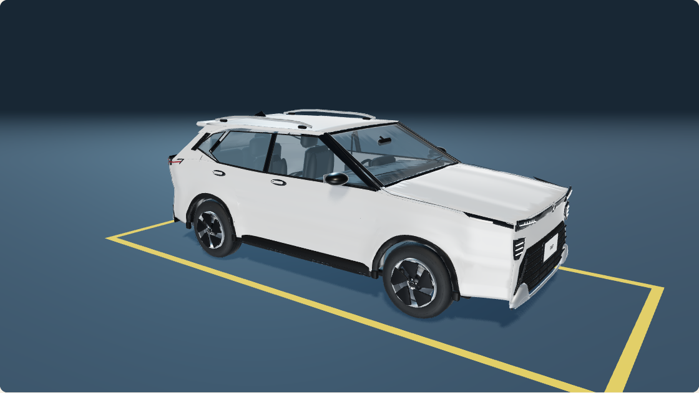

# Nissan Kait: estudio en Blender y vista del inicio

Dos pedidos puntuales del 2026-10-13: construir el modelo 3D a partir de las imágenes de `recursos/kait/` y mostrar renders (KAIT01); después, sustituir el auto de la página de inicio por ese Kait (KAIT02). El estudio original quedó en la rama local `asset-kait-preview`, base `72a1e87`; la integración del inicio está en el [PR #45](https://github.com/grunch/al-volante/pull/45), rama `kait02-home-preview`, desde `main` (`ecda93a`, con #43), en otro worktree. No inicia una fase del plan.

## Referencias

Se inspeccionaron las siete imágenes entregadas:

- `12004_im.jpg` y `12009_im.jpg`: frente en tres cuartos, capó, parrilla, ópticas, espejos, pasos de rueda y llantas.
- `12010_im.jpg`, `12011_im.jpg` y `12012_im.jpg`: laterales y parte trasera, portón, luces, spoiler, luneta, molduras y emblemas.
- `12016_im.jpg`: volante, tablero, salidas de aire, pantalla y consola.
- `12018_im.jpg`: detalles del sistema multimedia, climatizador y selector automático.

Las fotos se usan como referencia visual; sus píxeles no forman parte de las texturas del modelo. Las fotos del recorrido están ahora en `recursos/recorrido-13/`, fuera de Git.

Escala nominal de referencia: 4,304 m de largo, 1,760 m de ancho, 1,611 m de alto y 2,620 m entre ejes, según [Nissan Argentina](https://www.nissan.com.ar/vehiculos/nuevos/kait-2026/confort.html). El modelo aproxima superficies desde vistas en perspectiva: no es CAD del fabricante, ni una reconstrucción por fotogrametría. Las medidas de elementos pequeños, materiales, tapizados y posición interior son estimadas. La pantalla muestra contenido propio, no una copia de la interfaz fotografiada.

## Fuente y organización

`scripts/blender/build_kait.py` genera mallas, curvas y textos originales. Las colecciones separan carrocería, vidrios, detalles exteriores, ruedas, habitáculo y estudio. El conjunto del vehículo tiene un objeto raíz; luces y cámaras se mantienen fuera de ese conjunto. Se conserva geometría editable y materiales procedurales.

El modelo incluye paneles curvos con huecos y revestimientos en los pasos de rueda, ópticas por piezas, molduras, llantas bicolor con cinco palas, discos, tuercas y dibujo de neumático; espejos, limpiaparabrisas, luneta térmica, portón, parrilla, manijas y rieles de techo. En el interior hay volante con costuras y botones, instrumental, consola multimedia, climatizador, selector CVT, asientos, apoyacabezas, cinturones retraídos, paneles de puerta y pedalera.

Las inscripciones identifican el auto de referencia; el estudio no es un producto oficial de Nissan. No se incorpora un modelo de terceros ni se descargan texturas o bibliotecas.

## Reproducción

Blender 5.2.0 LTS, Cycles, GPU OptiX cuando está disponible. Desde la raíz del repositorio:

```sh
flatpak run --filesystem="$PWD" org.blender.Blender \
  --background --factory-startup \
  --python "$PWD/scripts/blender/build_kait.py" -- \
  --output "$PWD/test-results/kait"
```

Para revisar una vista con menos muestras:

```sh
flatpak run --filesystem="$PWD" org.blender.Blender \
  --background --factory-startup \
  --python "$PWD/scripts/blender/build_kait.py" -- \
  --output "$PWD/test-results/kait-draft" --draft --views front
```

Los resultados son `kait.blend`, `model-report.json` y las imágenes `kait-front.png`, `kait-rear.png`, `kait-side.png` y `kait-interior.png`. Los artefactos pesados permanecen fuera de Git. El script verifica coordenadas finitas y registra el número de objetos y triángulos evaluados. `--skip-renders` construye y guarda el estudio sin generar las cuatro imágenes.

## Entrega del estudio (KAIT01)

Modelo construido desde las siete referencias y cuatro renders terminados en 1800 × 1224, con 160 muestras y semilla 1303. Renderizado con Blender 5.2.0 LTS, Cycles y OptiX en RTX 2060 de 6 GB; generación y cuatro vistas completadas en aproximadamente 3 minutos y 5 segundos en esta ejecución. Es una medición del proceso de estudio, no del juego.

El informe geométrico registra 837 objetos del vehículo y 638.168 triángulos evaluados, con coordenadas finitas. La envolvente completa mide aproximadamente 2,160 × 4,408 × 1,627 m en ejes X/Y/Z: incluye espejos, antena, inscripciones y piezas salientes. Las dimensiones nominales son una referencia de construcción y no una certificación de las dimensiones finales.

Se reabrió el `.blend` guardado en un proceso independiente de Blender: coinciden los objetos, las cuatro cámaras, resolución, muestras y configuración de luces; no hay imágenes externas necesarias para abrirlo. Los cuatro PNG se decodificaron correctamente, tienen las dimensiones previstas y contenido no uniforme. También se inspeccionaron visualmente las cuatro vistas finales. No se ejecutaron pruebas del juego porque no se cambió su implementación.

La revisión visual independiente señaló pilares y sellos demasiado gruesos, aireadores sobresalientes, protectores de paragolpes planos y llantas estrechas. Se ajustaron esos cuatro puntos. La nueva fascia ocultó parte del instrumental durante una iteración: se recortó alrededor del cuadro y se ajustaron cámara y volante. Revisión final conforme para entregar este estudio aproximado, sin defectos visuales bloqueantes; no equivale a validación CAD o ergonómica.

Entrega local en `recursos/kait/modelo-3d/`: `.blend`, cuatro PNG, script, instrucciones e informes. Los artefactos permanecen fuera de Git; la fuente y el registro están en la rama local `asset-kait-preview`, sin PR de integración. Se conservan simplificaciones en las superficies, ópticas, llantas y tablero.

Los renders de estudio no acreditan rendimiento en tiempo real ni fidelidad dimensional de todos los detalles. KAIT02 prepara una versión para exhibir en el inicio. Integrarlo como vehículo de conducción requeriría otro trabajo sobre piezas móviles, pivotes y su relación con la simulación.

## Inicio del juego (KAIT02)



`src/assets/blender/kait.glb` es una exportación real del estudio, cargada por `GLTFLoader`. Conserva carrocería, ópticas, llantas, espejos, rieles, vidrios y habitáculo. El exportador elimina 214 detalles subpíxel, simplifica mallas y curvas y agrupa las superficies por material: 87.934 triángulos, 24 materiales y 1.848.348 bytes (1,85 MB decimal). El presupuesto máximo es 100.000 triángulos, 30 primitivas de malla del vehículo y 4 MB. El informe `kait-report.json` registra cantidades y SHA-256 de fuente y artefacto; una prueba carga el GLB real y verifica ese contrato.

No contiene fotos, texturas externas, luces ni cámaras. Los materiales PBR y el entorno de reflexión procedural son propios; el vidrio usa transparencia simple en lugar de transmisión física para limitar el costo. Se conserva la aproximación visual del estudio. La carrocería no es CAD del fabricante.

Para reconstruir el GLB desde código, sin depender del archivo `.blend` local:

```sh
flatpak run --filesystem="$PWD" org.blender.Blender \
  --background --factory-startup \
  --python "$PWD/scripts/blender/export_kait.py" -- \
  --output "$PWD/src/assets/blender"
```

También acepta `--source "$PWD/test-results/kait/kait.blend"` para exportar un estudio ya generado. El resultado versionado es el GLB ligero y su informe; el `.blend` y los renders de estudio siguen fuera de Git.

La escena aplica iluminación de estudio, reflejos suaves, sombras estáticas y mapeo tonal ACES. La cámara tarda 70 segundos por vuelta y ajusta la distancia a la proporción del lienzo. La preferencia de movimiento reducido detiene la órbita y evita cuadros continuos; ocultar la pestaña suspende el bucle. La descarga puede cancelarse, los resultados tardíos liberan sus recursos y los fallos dejan un mensaje accesible sin impedir la navegación. El nombre accesible identifica al Nissan Kait.

### Verificación de la integración

- Inspección en Chromium con GPU NVIDIA RTX 2060: escritorio 1440 × 1100 (DPR 1), móvil 390 × 844, angosto 320 × 740 y apaisado 844 × 390 (DPR 2). Sin desborde horizontal ni errores o advertencias de consola; encuadre revisado visualmente. La emulación móvil usa la GPU del escritorio, no acredita rendimiento en un teléfono físico.
- Pruebas de carga del GLB real, presupuesto, materiales, proporciones, errores HTTP y de parseo, cancelación durante descarga/parseo, desmontaje, liberación de recursos, pausa al ocultarse y movimiento reducido.
- 24 E2E de inicio y navegación aprobados en Chromium de escritorio y Pixel 7 emulado con WebGL por software. Incluyen descarga real, imagen estable con movimiento reducido, navegación ante fallo de red y salida durante una descarga pendiente; los seis casos del Kait volvieron a pasar tras precisar la aserción del mensaje de error. Validación completa en `ESTADO_IMPLEMENTACION.md`.

Medición local en Chromium 153.0.8010.12 con ANGLE/OpenGL y RTX 2060 de 6 GB, 180 cuadros tras 40 de calentamiento, una vuelta de cámara incluyendo el calentamiento, tiempo de `render` más `gl.finish()` (incluye espera de GPU), sombras reutilizadas. Con lienzo 1120 × 630 y DPR 1: el modelo anterior dibuja 418 triángulos/11 llamadas y promedia 0,85 ms (p95 4,0 ms); el Kait completo con suelo dibuja 89.596 triángulos/32 llamadas y promedia 1,78 ms (p95 4,5 ms). En lienzo móvil emulado 358 × 224 con DPR 2: 1,95 ms (p95 5,1 ms). Es una muestra con otros procesos de prueba activos en el equipo; mide costo del dibujo, no FPS garantizados ni rendimiento de teléfonos reales. La versión con movimiento reducido dibuja una vez y vuelve a dibujar solo si cambia el tamaño.

Se verificó también la ruta de reconstrucción desde código sin `--source`: produce las mismas cantidades de objetos, materiales, triángulos, dimensiones y bytes. El orden binario de parte de los vértices difiere respecto de exportar el `.blend` guardado, por lo que no se promete identidad SHA-256 entre ambas rutas. El hash del informe identifica el GLB concreto entregado.

**Compatibilidad pendiente con #44:** al revisar esta integración, la PWA seguía en un PR separado. Su patrón de precache debe incluir `glb` y admitir al menos 1.848.348 bytes por archivo (el límite propuesto allí era 1.800.000). Hasta integrar ese ajuste no se afirma disponibilidad del Kait sin conexión. No se modifica la rama de PWA desde este trabajo.
